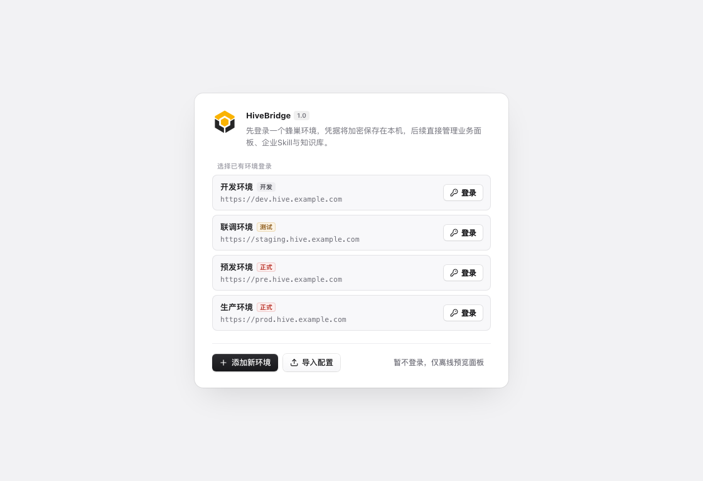
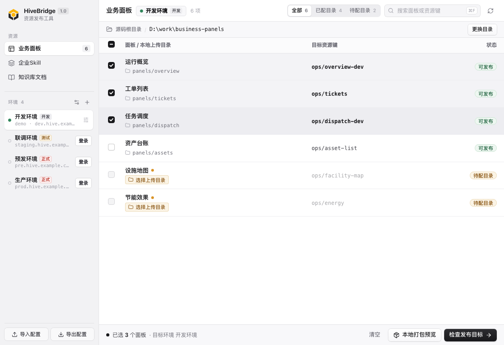
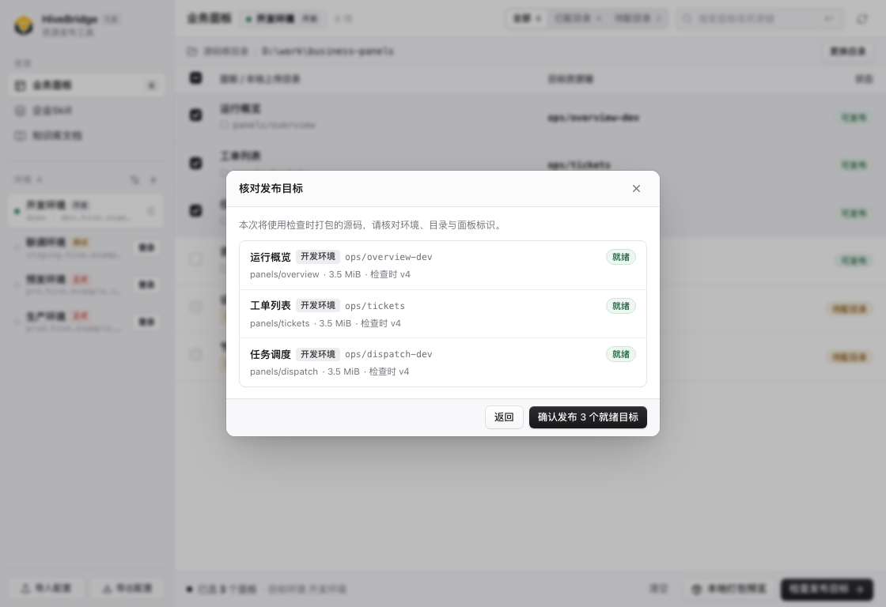
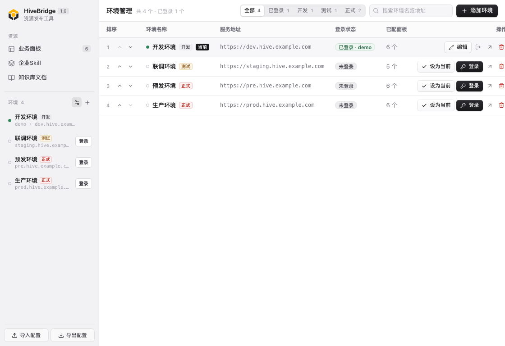
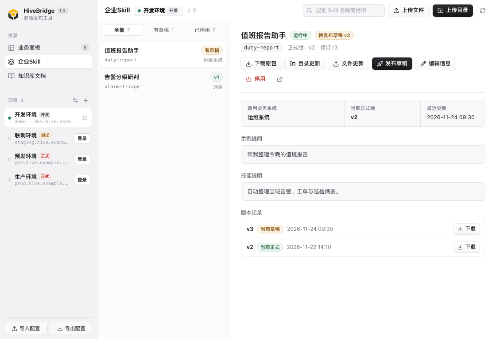
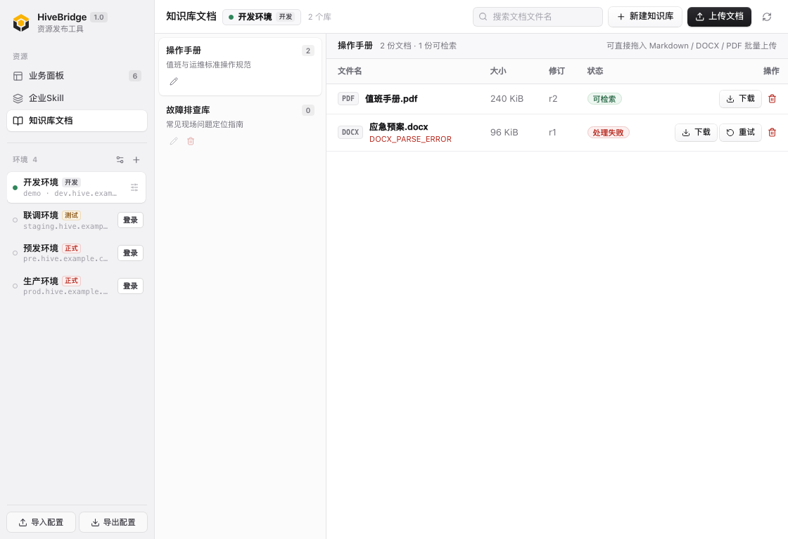

# HiveBridge

**HiveBridge** 是面向 **HiveOS** 的跨平台原生桌面资源发布与管理工作台（支持 macOS 与 Windows），基于 **Wails v2 + Go + Vue 3 + TypeScript** 构建。

它让开发者与运维人员在一个轻量、直观的原生桌面窗口中，一站式完成多环境下的 **业务面板发布**、**企业 Skill 双向管理（含目录自动打包）** 与 **知识库文档批量管理**，无需安装 Node.js 或 Go 运行时，也无需手工编辑 JSON 或每次重复输入密码。

---

## 核心特性

- **原生桌面体验，开箱即用**：macOS 使用系统 WebKit（支持 Apple Silicon 与 Intel 通用包），Windows 使用系统自带 Edge WebView2，安装包仅 5～8 MB。
- **前置登录与本地加密凭据**：首次启动直接引导登录；账号密码校验通过后使用 **AES-256-GCM** 加密保存在本机用户配置目录，重启应用无需重复登录。
- **多环境统一管理与自定义排序**：左侧下方为独立可滚动的环境切换列表（适配 4～10+ 套环境）；支持界面新增/编辑/删除环境、按类型打标（开发 / 测试 / 正式发布保护）以及自定义排序。
- **业务面板安全打包与核对发布**：自动剥离本地调试脚本与测试凭据注入、校验目录结构，支持离线打包预览、在线核对版本/草稿冲突及确认后发布。
- **企业 Skill 双向管理与目录自动打包**：先浏览当前环境的全部 Skill、版本与草稿状态；支持一键下载原包、**选中本地 Skill 目录自动打包成 ZIP 上传**、拖放文件夹/文件上传、发布草稿、编辑元信息与启停。
- **知识库与文档双栏管理**：支持新建/编辑/删除知识库、下载文档原件、对解析失败文档一键重试、以及多选或拖放批量上传（自动识别新增与替换同名文档）。

---

## 界面一览

### 1. 首次启动前置登录引导

首次打开应用且尚未登录任何环境时，会先进入简洁的登录引导页。可直接选择已导入的环境登录、点击「添加新环境」或「导入配置」，也可跳过登录先离线预览本地面板。



### 2. 业务面板发布工作台

左侧上方切换资源类型，左侧下方为独立可滚动的环境列表，单击任意环境即可切换右侧工作上下文。业务面板页聚焦展示当前目标环境的面板清单、本地源码目录、目标资源键与就绪状态，支持快捷键搜索（`⌘F` / `Ctrl+F`）和状态筛选。



点击「本地打包预览」可在离线状态下完成打包和脱敏校验；点击「检查发布目标」会自动复用已记住的加密凭据核对线上版本与草稿状态，确认无误后再执行发布（正式环境会自动展示醒目保护提示）。



### 3. 多环境管理与自定义排序

点击左侧「环境」标题栏的管理图标即可进入环境管理视图，支持按类型与登录状态筛选、搜索、上移/下移调整环境排序、编辑地址与标签、退出登录、删除环境及一键在浏览器中打开管理台。



### 4. 企业 Skill 双向管理（支持选目录自动打包）

切到「企业Skill」即可查看当前环境下的全部 Skill 列表、正式版、待发布草稿与历史版本：

- **下载与维护**：支持一键下载任意版本原包（ZIP 或 `SKILL.md`）、发布草稿、编辑显示名称/适用业务系统/示例提问，以及启用/停用。
- **选目录自动打包上传**：点击「上传目录」或详情区「目录更新」，直接选中包含 `SKILL.md` 的本地目录，程序会自动跳过 `.DS_Store`、`Thumbs.db`、`__MACOSX` 与 `.git`，拒绝符号链接及 `.env` 等敏感隐藏文件，保留脚本可执行权限并在内存中安全打成 ZIP 包（≤ 15 MiB）进入核对。
- **拖放上传**：支持直接把整个 Skill 文件夹、`SKILL.md`（≤ 2 MiB）或 ZIP 包（≤ 15 MiB）拖入窗口。



### 5. 知识库与文档双栏管理

切到「知识库文档」，左栏展示当前环境的全部知识库，右栏展示所选知识库下的文档列表、大小、修订号及处理状态（`可检索` / `处理中` / `处理失败`）。支持新建/编辑/删除空知识库、下载原件、失败重试，以及多选或直接拖放多个 Markdown / DOCX / PDF（单文件 ≤ 10 MiB）批量上传，上传前会自动汇总标出「新增文档」与「替换同名文档」。



---

## 快速开始

### 直接使用预编译安装包

1. **macOS**：解压 `hive-bridge-1.0-macos.zip`，将 `HiveBridge.app` 拖入「应用程序」目录或直接双击打开。
2. **Windows**：解压 `hive-bridge-1.0-windows.zip`，双击运行 `hivebridge.exe`。

### 配置方式（零配置或导入团队配置）

本开源仓库**不包含**任何私有环境地址或账号配置。你可以通过以下两种方式开始使用：

1. **纯界面添加**：打开应用后直接点击「添加新环境」，填入环境名称、服务地址、环境类型与管理员账号密码即可。
2. **导入团队 JSON 配置**：点击左下角「导入配置」，选择团队分发的 `hivebridge.json`（格式可参考仓库根目录的 [`hivebridge.example.json`](hivebridge.example.json)）。点击左下角「导出配置」可将当前环境和面板映射导出分享给团队成员（导出的配置**不含任何账号或密码**）。

配置文件与加密凭据托管在本机用户目录中，不要求程序安装目录可写：

| 平台 | 用户配置目录 |
| --- | --- |
| macOS | `~/Library/Application Support/hive-panel/` |
| Windows | `%AppData%\hive-panel\` |

目录内文件说明：
- `hivebridge.json`：托管的环境列表、排序、标签及业务面板映射。
- `source-root`：已记住的业务面板本地仓库根目录路径。
- `credentials.enc` 与 `.credentials.key`：管理员凭据的 AES-256-GCM 密文与本机随机密钥（权限 `0600`，严禁提交至 Git）。

### 配置文件示例

详见 [`hivebridge.example.json`](hivebridge.example.json)：

```json
{
  "panels": {
    "overview": {
      "name": "运行概览",
      "source": "panels/overview"
    }
  },
  "environments": {
    "开发环境": {
      "url": "https://dev.hive.example.com",
      "tag": "dev",
      "order": 1,
      "bindings": {
        "overview": "ops/overview-dev"
      }
    }
  }
}
```

字段说明：
- `panels.<alias>.name`：面板展示名称。
- `panels.<alias>.source`：面板源码在本地仓库根目录下的相对路径（可留空 `""` 表示待在界面中绑定目录）。
- `environments.<name>.url`：HiveOS 服务地址（支持 HTTP/HTTPS 与路径前缀，例如 `https://example.com/hive`）。
- `environments.<name>.tag`：可选环境类型，支持 `dev`（开发）、`test`（测试）、`prod`（正式，发布前展示保护提示）。
- `environments.<name>.order`：可选排序序号（正整数，越小越靠前）。
- `environments.<name>.bindings`：面板别名到远端 `<system_key>/<resource_key>` 的映射。

---

## 安全机制

- **本地凭据加密**：管理员凭据通过 AES-256-GCM 加密存储，密钥与本机主机名及用户目录绑定，密文文件权限为 `0600`。
- **短期会话及时注销**：每次登录校验、检查或操作结束后自动调用管理台 `DELETE /session` 注销会话，不残留长期有效会话。
- **安全打包与防误传**：
  - 业务面板自动剥离成对标注的本地测试注入脚本与弹窗调试身份，拒绝软链接、隐藏文件与非法路径。
  - 企业 Skill 目录打包自动跳过 `.DS_Store`、`Thumbs.db`、`__MACOSX`、`.git`，拒绝符号链接及 `.env` 等敏感隐藏文件。
- **写前核对与防重复提交**：业务面板与 Skill 上传均先经服务端 `inspect` 核对版本与草稿状态，确认令牌一次有效；正式环境发布前展示醒目保护提示。

---

## 从源码开发与构建

### 环境要求

- **Go** 1.24+（构建发布包推荐 Go 1.26）
- **Node.js** 20+（推荐 Node.js 24）
- macOS 构建通用包需安装 Xcode Command Line Tools（提供 `lipo`、`codesign`、`zip`）

### 运行测试

```bash
# 1. Go 单元测试（桌面入口 + 核心发布模块）
go test -v ./...
(cd publisher && go test -v ./...)

# 2. 前端类型检查与生产构建
(cd frontend && npm ci && npm run build)

# 3. 端到端桌面交互测试（Chromium + WebKit）
(cd frontend && npm run test:ui)
(cd frontend && HIVEBRIDGE_WEBKIT=1 npm run test:ui)

# 重新生成文档截图（写入 images/）
(cd frontend && HIVEBRIDGE_SCREENSHOTS=1 npm run test:ui)
```

### 打包跨平台分发包

在 macOS 上执行：

```bash
sh build.sh
```

脚本会编译前端并嵌入桌面程序，生成以下两个分发包到 `dist/` 目录（默认不包含任何本地私有配置）：

- `dist/hive-bridge-1.0-macos.zip`（macOS Apple Silicon + Intel 通用应用）
- `dist/hive-bridge-1.0-windows.zip`（Windows x64 可执行程序）

> 如团队内部打包需要随包附带本地未入库的 `hivebridge.json`，可执行：`BUNDLE_CONFIG=1 sh build.sh`。

---

## 目录结构

```text
hive-bridge/
├── main.go                    # Wails 桌面应用入口与前后端绑定方法
├── config_path.go             # 默认配置路径发现（兼容 hivebridge.json / hive-panel.json）
├── build.sh                   # macOS 通用包 + Windows x64 一键交叉构建脚本
├── hivebridge.example.json    # 公开配置文件示例（实际配置 hivebridge.json 已加入 .gitignore）
├── brand.svg                  # 应用矢量图标
├── assets/                    # macOS (.icns) 与 Windows (.ico / manifest / versioninfo) 资源
├── images/                    # 文档截图
├── publisher/                 # 独立 Go 发布核心模块（纯标准库）
│   ├── config.go              # 配置解析、校验与环境排序
│   ├── credentials.go         # AES-256-GCM 本地加密凭据存储
│   ├── workspace.go           # 工作区状态、环境增删改排、面板绑定与配置导入导出
│   ├── package.go             # 业务面板安全打包与调试代码脱敏
│   ├── batch.go               # 业务面板检查与确认发布批次
│   ├── skills.go              # 企业 Skill 双向管理与目录自动打包上传
│   ├── knowledge.go           # 知识库与文档双向管理及批量上传
│   ├── uploads.go             # 通用文件选择、检查与提交
│   ├── client.go              # HiveOS 管理台 HTTP API 客户端
│   └── cli.go                 # 兼容命令行批量发布入口
└── frontend/                  # Vue 3 + TypeScript + Vite 桌面前端
    ├── src/
    │   ├── App.vue            # 主窗口骨架、前置登录、左侧环境列表与业务面板页
    │   ├── EnvironmentsView.vue # 环境管理与排序视图
    │   ├── SkillsView.vue     # 企业 Skill 双向管理与目录/拖放上传视图
    │   ├── KnowledgeView.vue  # 知识库与文档双栏管理视图
    │   ├── bridge.ts          # Wails Go 方法 TypeScript 类型定义
    │   └── style.css          # 原生桌面风格样式系统
    └── test/
        └── desktop-flow.mjs   # Playwright（Chromium / WebKit）端到端测试与截图脚本
```

---

## License

本项目基于 [MIT License](LICENSE) 开源。
